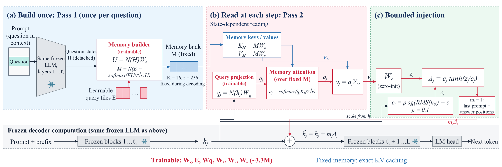
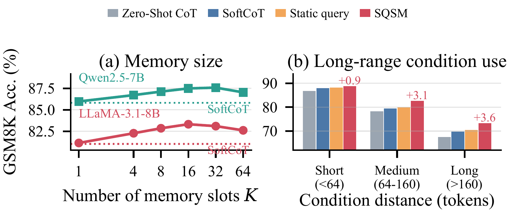
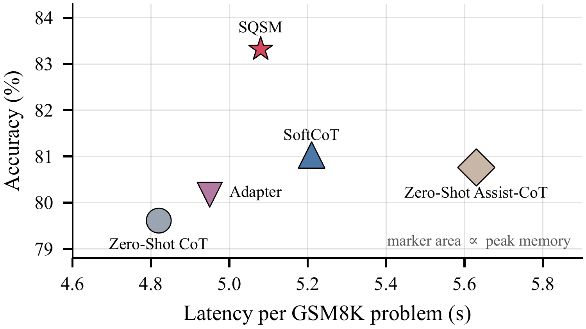

# Self-Query Soft Memory (SQSM)

Anonymous research implementation accompanying the SQSM manuscript.

SQSM equips a frozen causal language model with a small memory that it builds
from the question and reads throughout reasoning. A single backbone performs
both passes. There is no assistant model and no online memory writing.



## Method

1. **Build once.** Pass 1 stops after block `floor(L/3)`. Detached question states
   are normalized and projected to dimension `r`. Learnable slot queries compress
   them into a fixed `K × r` memory. Instructions, answer prefixes and padding
   are excluded using token offsets from the actual chat template.
2. **Read at every step.** After block `floor(3L/4)`, the current hidden state
   queries the memory keys and reads its values. This includes the last prompt
   position, which predicts the first answer token.
3. **Bound the residual.** A zero-initialized output projection maps the read
   vector to the backbone width. The update is bounded by
   `c * tanh(z/c)`, with `c = 0.1 * stop_gradient(RMS(h)) + 1e-6`.

Only `Ws, E, Wq, Wk, Wv, Wo` are trained. The parameter count is
`3*d*r + 2*r*r + K*r`: **3,280,896** for LLaMA-3.1-8B and **2,887,680** for
Qwen2.5-7B with `K=16, r=256`. Normalization, memory attention and the loss use
FP32. The backbone can use BF16 and stays in evaluation mode during training.

Training uses answer-token-weighted causal cross-entropy (`lambda=2`) and a
small relative-residual penalty (`beta=0.001`). Each sample is normalized by its
own supervised-token weight. Gradients pass through the frozen upper blocks.
Pass-1 states may be cached, but trainable memory construction is recomputed.

Generation discards Pass-1 cache, prefills again with the module enabled, and
keeps the memory fixed. Cached and full causal decoding therefore have the
same computation definition, up to floating-point roundoff.


## Setup

Python 3.10–3.12 is supported. Install a CUDA-enabled PyTorch build appropriate
for your machine before installing the project. The manuscript environment uses
PyTorch 2.3.1 and Transformers 4.44.2; the package pins Transformers 4.44.2.

```bash
python -m venv .venv
# Activate .venv using the command for your shell.
python -m pip install -e ".[test]"
python -m pytest -q
```

The main tested decoder families are LLaMA and Qwen2/Qwen2.5. Model weights
are downloaded by Transformers or loaded from a local directory. Gated models
require your own access authorization. Credentials are never embedded in code.

## Datasets

```bash
python scripts/prepare_data.py --data-dir data --seed 42
```

The script reuses existing GSM8K files and downloads the remaining sources.
All raw files, normalized examples, split manifests and source hashes stay in
`data/`, which is excluded from Git in its entirety.

| Task | Source | Raw training pool | Evaluation |
|---|---|---:|---:|
| GSM8K | Github: openai/grade-school-math | 7,473 | 1,319 |
| ASDiv-Aug | Hugging Face: xuyige/ASDiv-Aug | 4,183 | 1,038 |
| AQuA | Github: google-deepmind/AQuA | 97,467 | 254 |
| StrategyQA | Official StrategyQA distribution | 1,832 | 458 |
| Date Understanding | Github: suzgunmirac/BIG-Bench-Hard | None | 250 |

StrategyQA follows the supplied baseline's file-order 80/20 partition of the
2,290 labeled questions. Its available supporting facts serve as reference
rationale. A separate development set is held out from training: 150 examples
for StrategyQA and at least 200 for the other tasks. Group integrity can make
the development set slightly larger. Test-overlapping lexical/numeric variants
are excluded from training. AQuA's official development file is also retained
separately. DU is evaluation-only; its module is trained on `data/union`, with
at most 7,473 eligible training examples per task.

The public ASDiv-Aug release does not provide paraphrase-family identifiers.
The preparation script groups lexical duplicates and numeric variants, but
cannot establish all paraphrase relationships. Exact manuscript split IDs and
teacher-generated rationale artifacts were not supplied. The generated manifest
records these reconstruction choices; they should not be described as exact
recovery of unavailable experimental artifacts.

## Training

```bash
python train.py --config configs/qwen2.5-7b.json --train data/gsm8k/train.jsonl --dev data/gsm8k/dev.jsonl --output runs/qwen-gsm8k/seed-0 --seed 0 --cache-sources
```

Use `configs/llama3.1-8b.json` for the other main backbone. Defaults are AdamW,
learning rate `1e-4`, weight decay `0.01`, 5% warmup and cosine decay, two
epochs, micro-batch size 1, accumulation 16, and gradient norm clipping at 1.
Use `--epochs 1` for AQuA. Whole examples longer than 1,536 tokens are filtered
and logged; answers are never silently truncated.

The best epoch is selected by free-generation development accuracy. `best/`
and `last/` contain only module weights and configuration, not backbone weights.
Run metadata includes data hashes, resolved model revision, parameter count,
seed and filtered example IDs. Output directories cannot silently overwrite an
existing run. Fix `revision` in configuration for a pinned backbone revision.

For a small server-side learning check, add `--limit 32 --dev-limit 8`. This
checks execution and learnability, not benchmark performance. The training CLI
does not currently implement optimizer-state resume or gradient checkpointing.

## Evaluation and the five-seed grid

```bash
python evaluate.py --model Qwen/Qwen2.5-7B-Instruct --checkpoint runs/qwen-gsm8k/seed-0/best --data data/gsm8k/test.jsonl --output runs/qwen-gsm8k/seed-0/test.jsonl
python evaluate.py --model Qwen/Qwen2.5-7B-Instruct --baseline --data data/gsm8k/test.jsonl --output runs/base-gsm8k/test.jsonl
python scripts/run_experiments.py
# Review the printed commands, then run the complete grid:
python scripts/run_experiments.py --execute
python scripts/aggregate_results.py runs/qwen2.5-7b/gsm8k
```

The grid uses seeds 0–4 as a documented choice because the manuscript specifies
five runs without enumerating the seeds. Generation is greedy with at most
1,024 new tokens. Evaluation writes raw predictions, parsed answers, correctness,
truncation flags, total per-question latency and first-token latency. Timings
include source extraction, memory construction and enabled prefill. The
aggregator refuses to substitute manuscript values for missing runs.

## Ablations

`train.py --variant static` fixes the query to the last-prompt state;
`--variant direct` reads uncompressed projected question states;
`--variant unbounded` removes the tanh bound; `--no-reg` removes the penalty.
`--variant adapter` trains a bias-free GELU bottleneck at the same layer with
the nearest available parameter count, which is reported exactly in run metadata.
Each variant needs its own training and development selection.

The original SoftCoT/SoftCoT++ source is preserved under `baselines/softcot` for
reference and separate baseline runs. Its original environment and data loader
are not used by SQSM. Github: xuyige/SoftCoT.

## Figures and result status

The following figures were copied from the accompanying manuscript. They are
manuscript illustrations, **not results newly measured by this implementation**.
This release does not contain trained SQSM checkpoints or completed full-scale
benchmark runs. Use the evaluation artifacts from actual runs to verify results.





## Repository layout

```text
sqsm/                 Model, memory, data encoding and metrics
configs/              Main backbone and training settings
train.py              Supervised module training
evaluate.py           Free-generation evaluation
scripts/              Data preparation, experiment grid, aggregation
tests/                Small-model correctness and learning checks
figures/              Manuscript framework and selected result illustrations
baselines/softcot/    Preserved upstream baseline source
docs/                 Implementation mapping and validation record
data/                 Local datasets and manifests; excluded from Git
runs/                 Local checkpoints and predictions; excluded from Git
```

## Attribution and license

This is a substantially reworked SQSM implementation, dated 2026-10-13, built
from a local copy of SoftCoT. It is not an upstream SoftCoT release. The original
baseline source and its license notices are retained. The root `LICENSE`
preserves the upstream non-commercial terms; no broader rights are asserted.
Datasets and backbone weights remain subject to their respective terms.
